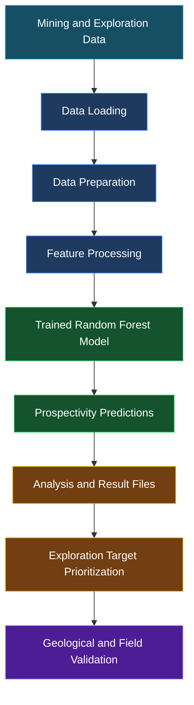

# ⛏️ MOIL MnAI — AI-Powered Manganese Exploration

### Discover Potential. Map Intelligence. Explore Smarter.

**MOIL MnAI** is a machine learning-based mineral exploration project that uses the **Random Forest algorithm** to analyze manganese-related, mining, and environmental datasets to identify areas with potentially favorable characteristics for manganese mineralization.

The project explores how data-driven analysis can support preliminary mineral prospectivity assessment, generate prediction outputs, and help prioritize areas for further geological investigation.

By combining machine learning with mineral exploration data, MOIL MnAI aims to make exploration analysis more systematic, efficient, and informed by data.

<p align="center">
  
  
  
  
</p>

---

## 📌 Table of Contents

- [Project Overview](#-project-overview)
- [Objectives](#-objectives)
- [Key Features](#-key-features)
- [How It Works](#-how-it-works)
- [Machine Learning Workflow](#-machine-learning-workflow)
- [Repository Structure](#-repository-structure)
- [Technology Stack](#-technology-stack)
- [Getting Started](#-getting-started)
- [Project Outputs](#-project-outputs)
- [Potential Applications](#-potential-applications)
- [Limitations](#-limitations-and-disclaimer)
- [Future Enhancements](#-future-enhancements)
- [Contributing](#-contributing)
- [License](#-license)

---

## 🌍 Project Overview

Mineral exploration requires the analysis of geological observations, mineral occurrence information, mining records, and environmental characteristics to identify areas that may warrant further investigation.

Traditional exploration can involve extensive fieldwork and the interpretation of multiple datasets. Machine learning offers an additional approach by identifying patterns in available data and using those patterns to estimate mineral prospectivity.

MOIL MnAI investigates this approach using a **Random Forest classifier or prediction model**, depending on the implemented training pipeline. The project includes a saved model, exploration-related datasets, and CSV files associated with manganese analysis and prospectivity predictions.

The intended outcome is to support the identification and prioritization of potentially promising exploration zones for subsequent geological assessment.

> **Important:** A high prospectivity prediction indicates a model-estimated potential based on the available input features. It does not confirm the presence of a manganese deposit.

## 🎯 Objectives

- Analyze manganese-related and mining datasets using Python.
- Apply a Random Forest machine learning model to exploration data.
- Generate predictions based on the features expected by the trained model.
- Organize prospectivity results into structured output files.
- Incorporate relevant environmental features into the analytical workflow where supported by the implementation.
- Support preliminary exploration target prioritization.
- Establish a foundation for future geographic visualization and geological validation.

## ✨ Key Features

| Feature | Description |
|---|---|
| 🤖 Random Forest | Uses a saved machine learning model for prediction. |
| ⛏️ Manganese Analysis | Includes manganese-related exploration data and analysis outputs. |
| 📊 Data Processing | Organizes mining, manganese, and environmental datasets. |
| 🌱 Environmental Features | Includes an environmental feature dataset for analysis. |
| 🎯 Prospectivity Prediction | Produces prediction-related outputs for exploration assessment. |
| 📁 Structured Results | Stores analysis and prediction results in CSV files. |
| 🖥️ Dashboard Data | Includes a JSON file for dashboard-related data. |
| 🔬 Extensible Workflow | Provides a foundation for additional evaluation, visualization, and validation. |

The exact functionality of each component depends on the implementation in `app.py` and the model's training pipeline.

---

## 🧠 How It Works

MOIL MnAI follows a machine learning-based exploration workflow.



### Workflow Explanation

**1. Data Loading**

Load the available manganese, mining, and environmental datasets from the project files.

**2. Data Preparation**

Prepare the input data in the format required by the application and the saved model. This may involve handling missing values, selecting columns, and ensuring compatible data types, depending on the implementation.

**3. Feature Processing**

Select and arrange the features expected by the trained Random Forest model. Prediction inputs must be consistent with the features used during training.

**4. Model Inference**

Load the serialized model from `mn_prospectivity_rf.pkl` and use it to generate predictions for compatible input data.

**5. Prospectivity Analysis**

Store or process the resulting predictions using the application's analysis pipeline.

**6. Exploration Target Prioritization**

Use the prediction results to help identify areas that may deserve additional investigation.

**7. Geological Validation**

Compare promising predictions against reliable geological information and, where appropriate, field observations before drawing conclusions.

*This diagram represents the project's intended workflow. The exact implemented steps, model type, and output calculations should be verified in `app.py` and the model training code.*

---

## 🗂️ Repository Structure

```text
MOIL-MnAI/
│
├── README.md
├── app.py
├── requirements.txt
│
├── dashboard_data.json
│
├── environmental_features.csv
├── manganese_analysis.csv
├── manganese_uploaded_latest.csv
├── mining_data.csv
│
├── mn_prospectivity_rf.pkl
│
├── prospectivity_output.csv
├── prospectivity_predictions.csv
└── shortfall_analysis.csv
```

### 📁 File Descriptions

| File | Purpose |
|---|---|
| `README.md` | Project overview, documentation, and setup instructions. |
| `app.py` | Main Python application and analysis entry point. |
| `requirements.txt` | Python package dependencies. |
| `dashboard_data.json` | Data associated with dashboard functionality. |
| `environmental_features.csv` | Environmental feature dataset. |
| `manganese_analysis.csv` | Manganese-related analysis data. |
| `manganese_uploaded_latest.csv` | Latest uploaded manganese dataset included in the repository. |
| `mining_data.csv` | Mining-related dataset. |
| `mn_prospectivity_rf.pkl` | Serialized Random Forest model used for inference, if loaded by the application. |
| `prospectivity_output.csv` | Prospectivity analysis output. |
| `prospectivity_predictions.csv` | Model prediction results. |
| `shortfall_analysis.csv` | Shortfall-related analysis data. |

**Note:** These descriptions reflect the filenames and intended roles of the files. Their precise schemas, generation methods, and relationships should be confirmed from the application and dataset contents.

---

## 🛠️ Technology Stack

| Technology | Role |
|---|---|
| **Python** | Core programming language. |
| **Scikit-learn** | Machine learning model development and inference. |
| **Pandas** | Tabular data loading and processing. |
| **NumPy** | Numerical computation and array operations. |
| **CSV** | Storage of structured datasets and analysis results. |
| **JSON** | Storage of dashboard-related data. |
| **Pickle** | Serialization format for the saved model, as indicated by the `.pkl` file. |
| **Git & GitHub** | Version control and project hosting. |

Additional libraries for visualization, geospatial processing, or dashboard development should be documented if they are used by the actual application.

---

## 🚀 Getting Started

Follow these steps to run the project locally.

### Prerequisites

- Python installed on your computer.
- Git installed if you plan to clone the repository.
- The project files and datasets.
- The Python dependencies listed in `requirements.txt`.

### 1. Clone the Repository

```bash
git clone <YOUR_GITHUB_REPOSITORY_URL>
cd MOIL-MnAI
```

Replace `<YOUR_GITHUB_REPOSITORY_URL>` with the actual HTTPS or SSH URL of your GitHub repository.

Alternatively, download the repository as a ZIP file and extract it.

### 2. Create a Virtual Environment

```bash
python -m venv venv
```

Activate the environment on Windows:

```powershell
venv\Scripts\activate
```

On Linux or macOS:

```bash
source venv/bin/activate
```

### 3. Install Dependencies

```bash
python -m pip install --upgrade pip
pip install -r requirements.txt
```

### 4. Run the Application

```bash
python app.py
```

This command is appropriate if `app.py` is designed to run directly as a Python script.

If the project uses a framework such as Streamlit or Flask, follow the launch command required by that framework instead.

### 5. Review the Results

After running the application, inspect the prediction and analysis files to understand which outputs were created or updated.

Relevant files include:

- `prospectivity_predictions.csv`
- `prospectivity_output.csv`
- `shortfall_analysis.csv`
- `dashboard_data.json`

The exact output files and their locations depend on the implementation.

---

## 📊 Project Outputs

The repository contains several files associated with analysis and prediction results.

| Output | Intended Use |
|---|---|
| `prospectivity_predictions.csv` | Stores prospectivity prediction results. |
| `prospectivity_output.csv` | Stores the application's prospectivity analysis output. |
| `shortfall_analysis.csv` | Stores shortfall-related analytical results. |
| `dashboard_data.json` | Supplies data for dashboard-related functionality. |

### Understanding Prospectivity Results

The meaning of individual columns depends on the dataset and prediction pipeline. Before interpreting the outputs, verify:

- What each prediction column represents.
- Whether the model returns class labels, probabilities, or another score.
- Whether the scores have been calibrated or validated.
- How locations or geographic coordinates are associated with the predictions.
- Whether the output has been checked against known manganese occurrences.

If geographic coordinates and suitable spatial data are available, the results could be used in a future GIS-based mineral prospectivity mapping workflow.

---

## 🌏 Potential Applications

MOIL MnAI explores potential applications in:

- **Preliminary mineral prospectivity assessment:** Identify data patterns associated with potentially favorable areas.
- **Exploration target prioritization:** Help rank areas for further investigation when reliable location-linked predictions are available.
- **Mining data analysis:** Examine patterns across available mining and manganese datasets.
- **Environmental feature analysis:** Investigate environmental variables included in the analytical workflow.
- **Geological decision support:** Provide an additional source of evidence for exploration planning.
- **Future GIS integration:** Support the development of spatial prospectivity maps when geographic data and mapping functionality are available.

These are potential applications, not claims of validated field performance.

---

## ⚠️ Limitations and Disclaimer

MOIL MnAI is a machine learning-based exploration project intended to support preliminary analysis. Its predictions must not be interpreted as proof of manganese mineralization, confirmed deposits, or economically recoverable reserves.

The reliability of any prediction depends on several factors:

- Quality, coverage, and representativeness of the input datasets.
- Relevance and consistency of the model features.
- Training data quality and class balance.
- Appropriate training, testing, and validation procedures.
- Geographic coverage and potential sampling bias.
- Suitability of the model for the region or data on which it is applied.

A model can produce predictions even when its accuracy has not been established. Appropriate evaluation using independent geological observations is necessary before relying on results for exploration decisions.

**MOIL MnAI should complement, not replace, geological expertise, geochemical and geophysical investigations, and field verification.**

### Model and Data Security

Only load serialized model files from trusted sources. Pickle-based model files can execute arbitrary code during deserialization, so untrusted `.pkl` files should not be loaded.

---

## 🔮 Future Enhancements

Potential directions for improving the project include:

- 🗺️ **Interactive GIS Mapping** — Display prospectivity results on geographic maps.
- 📍 **Spatial Target Visualization** — Associate predictions with coordinates and visualize exploration zones.
- 📈 **Model Evaluation** — Report appropriate metrics such as precision, recall, F1-score, ROC-AUC, or PR-AUC where applicable.
- 🧪 **Independent Validation** — Test predictions against verified geological observations and suitable held-out data.
- 🛰️ **Remote Sensing Integration** — Explore relevant satellite-derived and geological features.
- 📤 **Dataset Upload Support** — Allow users to provide compatible datasets for analysis.
- 📊 **Improved Dashboard** — Present prediction results and analytical summaries more clearly.
- 🌳 **Feature Importance Analysis** — Examine which input features contribute to model predictions.
- 🔁 **Reproducible Training Pipeline** — Document data preparation, model training, validation, and model versioning.
- 📝 **Dataset Documentation** — Record column definitions, units, sources, geographic coverage, and data limitations.

These enhancements depend on data availability, the existing implementation, and appropriate validation.

---

## 🤝 Contributing

Contributions that improve the project's data processing, machine learning workflow, documentation, validation, or visualization are welcome.

To contribute:

1. Fork the repository.
2. Create a branch for your changes.
3. Make and test your modifications.
4. Document any new dependencies or data requirements.
5. Submit a pull request describing the changes and their purpose.

For changes to model behavior, include appropriate evaluation results where possible. Do not include confidential, restricted, or improperly licensed datasets.

---

## 📜 License

No license has been specified in the current project documentation.

Before distributing the repository, choose an appropriate open-source license and add a `LICENSE` file. Also verify that you have permission to redistribute the datasets and the serialized model.

Until a license is added, do not assume that the repository is available for unrestricted reuse.

---

<p align="center">
  <strong>⛏️ MOIL MnAI</strong>
  <br />
  <em>Turning Exploration Data into Smarter Mineral Insights.</em>
</p>

